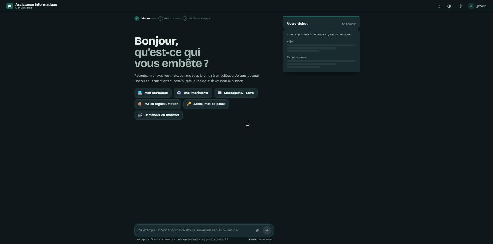

# Assistant de saisie de tickets GLPI / HelpGLPI Assistant

Une page web qui aide les utilisateurs peu à l'aise à signaler un problème. Ils racontent avec leurs mots, l'assistant pose une ou deux questions seulement si une information indispensable manque, puis rédige un ticket clair qu'ils relisent avant de l'envoyer. Les captures d'écran se collent avec Ctrl + V.

- **Connexion** : SSO Windows (Kerberos / SPNEGO), sans mot de passe.
- **GLPI** : le ticket est créé par un compte de service, l'utilisateur SSO est le demandeur. API legacy `apirest.php` (GLPI 10 et 11) ou API v2 (GLPI 11).
- **IA** : modèle local, API compatible OpenAI (vLLM, llama.cpp, LM Studio, Ollama `/v1`) ou API native d'Ollama.
- **Administration** : `/admin`, tout se règle et se teste depuis le navigateur.



## Contenu

```
backend/app/       API FastAPI : SSO, agent, GLPI, administration
frontend/          interface (HTML/CSS/JS sans build, polices auto-hébergées)
deploy/            Caddyfile (HTTPS) et krb5.conf
tests/             faux GLPI et faux LLM pour essayer sans rien brancher
Dockerfile, docker-compose.yml, .env.example
```

## Installation

Démarrage rapide, GLPI, modèle IA, SSO Kerberos, HTTPS et administration : voir [INSTALL.md](INSTALL.md).

## Ce que reçoit le technicien

- un titre court et factuel ;
- un résumé à la troisième personne ;
- une liste de faits (appareil, logiciel, depuis quand, personnes touchées…) ;
- le message d'origine et les réponses aux questions (désactivable) ;
- le type, l'urgence (de 2 à 5 selon la gêne déclarée), la catégorie, le lieu du demandeur et les pièces jointes.

Si une pièce jointe est refusée par GLPI, le ticket est quand même créé : l'utilisateur en est averti et l'erreur apparaît dans le journal.

## Futures fonctionnalités

Voir [ROADMAP.md](ROADMAP.md).

## Sécurité

- **Session** : cookie signé, HttpOnly, SameSite=Lax, Secure derrière HTTPS ; durée réglable.
- **Requêtes** : les appels qui modifient quelque chose exigent un en-tête propre à l'application (protection CSRF).
- **Redirections** : seules les redirections internes sont acceptées après connexion.
- **Contenu** : le texte saisi est échappé avant d'être envoyé à GLPI.
- **Fichiers** : les pièces jointes sont filtrées par extension et par taille.
- **Questions de l'agent** : l'agent a pour consigne de ne jamais demander de mot de passe.
- **Conteneur** : il tourne avec un utilisateur non root.

## Soutien

L'outil vous rend service ?

[](https://buymeacoffee.com/jpthony)
